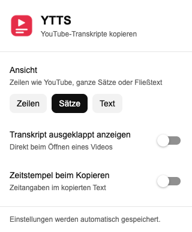
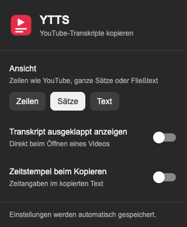

# YTTS

YouTube transcripts, ready to copy. A small Chromium extension that puts the
transcript above the watch page's recommendations and matches YouTube's light
and dark themes. The interface is in German.

- **One click to copy** the full transcript as plain text.
- **Collapsed by default**, with an expandable transcript and clickable timestamps.
- **Three views:** YouTube's caption lines, grouped sentences, or continuous text.
- **No build step, account, API key, analytics, or external service.**

Chapters are preserved as Markdown headings. Copied text contains only the
transcript, with optional timestamps. You can also choose whether the card opens
expanded by default.

| Light | Dark |
| --- | --- |
|  |  |

Transcript card: [light theme](docs/screenshots/youtube-light.png) ·
[dark theme](docs/screenshots/youtube-dark.png).

## Install

1. [Download the source](https://github.com/maphel/YTTS/archive/refs/heads/main.zip)
   and unzip it, or clone this repository.
2. Open `chrome://extensions` in Chrome, `edge://extensions` in Edge, or
   `brave://extensions` in Brave.
3. Turn on **Developer mode**.
4. Choose **Load unpacked** and select the `extension/` folder.
5. Open a YouTube video with a transcript. The **Transkript** card appears above
   the related videos: in the sidebar on the classic layout, or below the video
   on YouTube's newer layout.

Pin YTTS in the browser toolbar to reach its settings. After updating the files,
reload YTTS on the extensions page and refresh your YouTube tab.

## Settings

| Setting | Default | Effect |
| --- | --- | --- |
| Ansicht | Sätze | Choose **Zeilen**, **Sätze**, or **Text**. |
| Transkript ausgeklappt anzeigen | Off | Opens the transcript card automatically. |
| Zeitstempel beim Kopieren | Off | Includes line timestamps or sentence time ranges. |

**Zeilen** shows YouTube's caption segments. **Sätze** groups fragments using
punctuation and length/time limits; this is a heuristic, especially for automatic
captions without punctuation. **Text** displays these groups as paragraphs.
Sentence time ranges are approximate, using the next segment's start or the
video duration, with an estimated fallback if the duration is unavailable.

Copying without timestamps always produces paragraph text. With timestamps,
**Zeilen** preserves the original segment timestamps; **Sätze** and **Text** use
the grouped sentence ranges.

Settings use the browser's extension sync storage. Transcripts are read from the
current page and kept in memory; YTTS has no backend and sends no transcript data
to an external service. See [Privacy](PRIVACY.md) for details.

## How it works

YTTS opens YouTube's native transcript panel invisibly, reads its rendered
segments, then closes the panel if YTTS opened it. It supports both native
transcript segment layouts currently handled by the source.

A video must have a transcript available in YouTube. Loading may take a few
seconds, and changes to YouTube's interface can affect compatibility. YTTS uses
the transcript YouTube provides; it does not generate or translate captions.

The extension uses Manifest V3, the `storage` permission, and a content script
limited to `https://www.youtube.com/*`. There are no runtime dependencies. See
[Lessons learned](LESSONS_LEARNED.md) for the implementation constraints.

## Development

Edit the files in `extension/`, reload the unpacked extension, and refresh the
YouTube tab. Please read [Contributing](CONTRIBUTING.md) before making changes.

## License

[MIT](LICENSE) · Copyright © 2026 Marcel Christophel.

Interface icons include Apache-2.0-licensed Material Icons; see
[third-party notices](extension/THIRD_PARTY_NOTICES.md).

YTTS is an independent project and is not affiliated with YouTube or Google.
